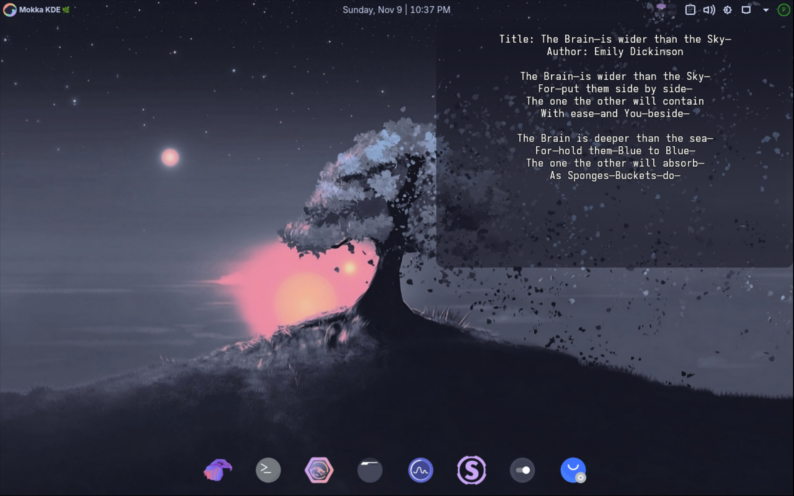
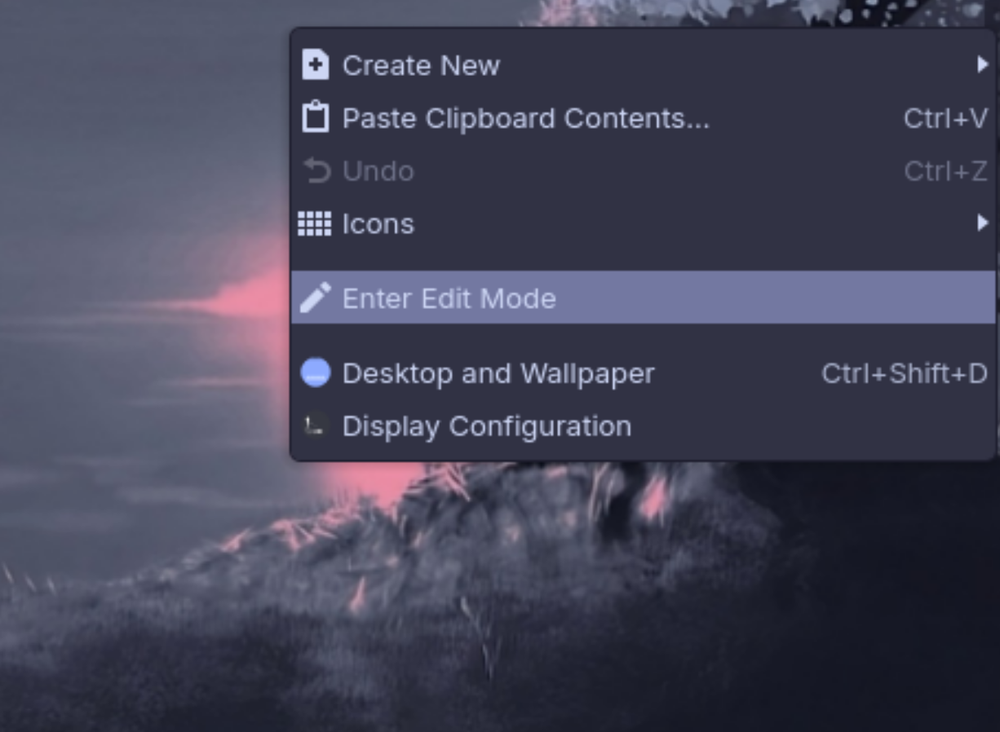
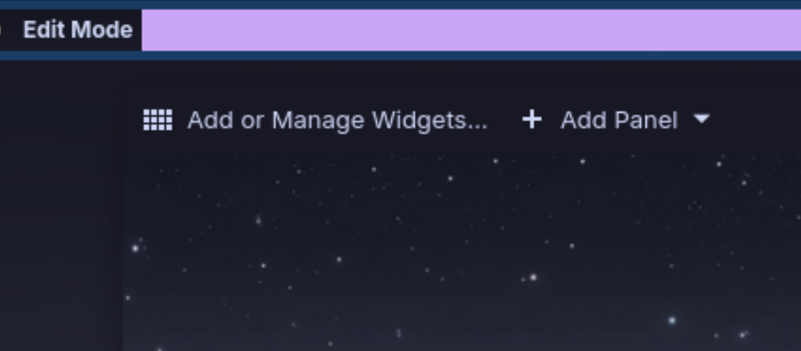
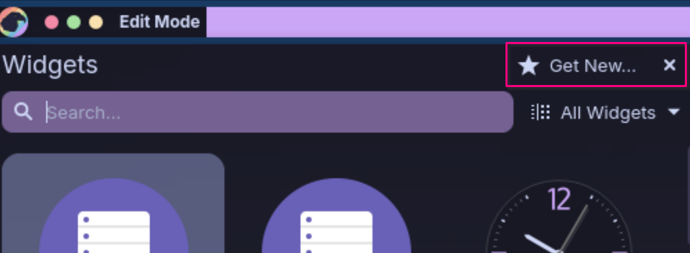
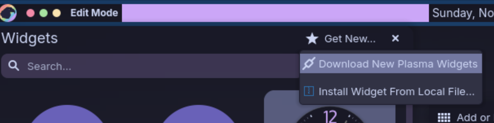
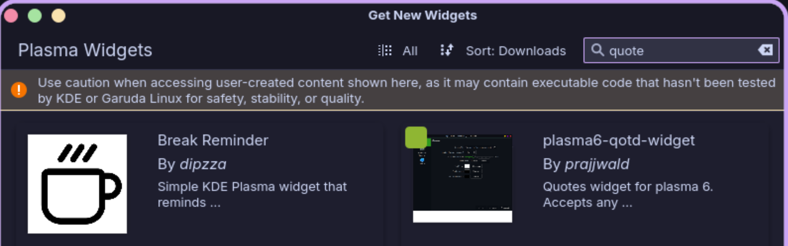
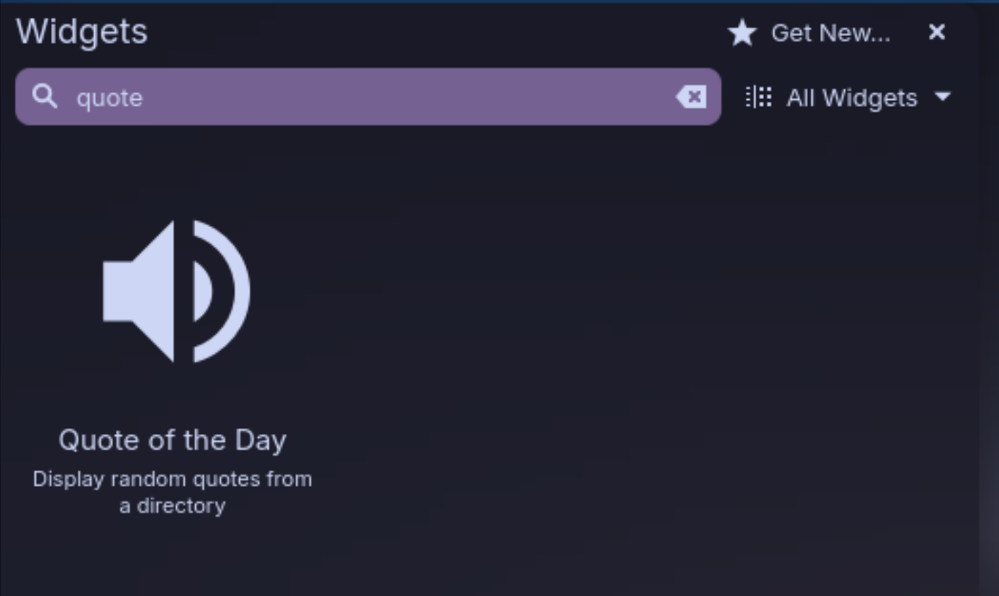
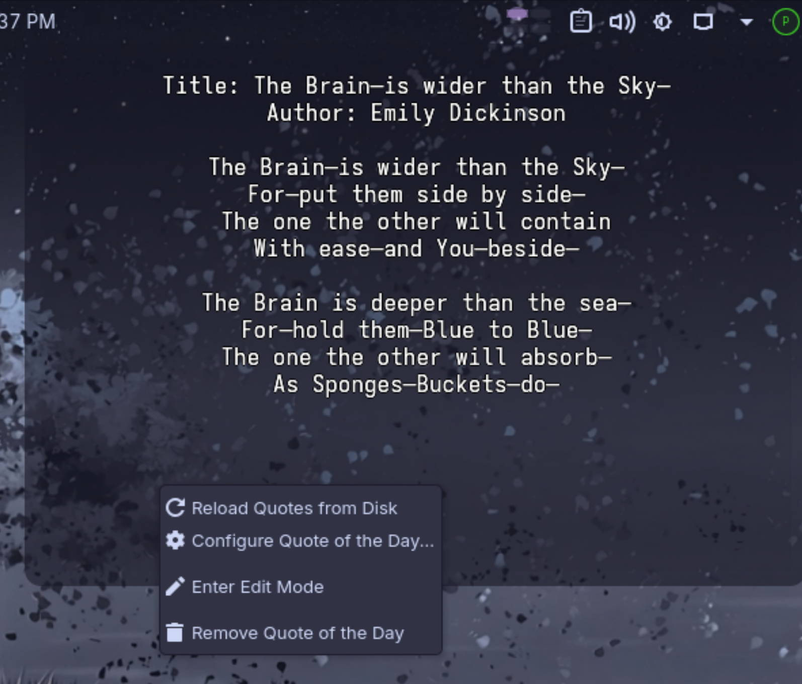
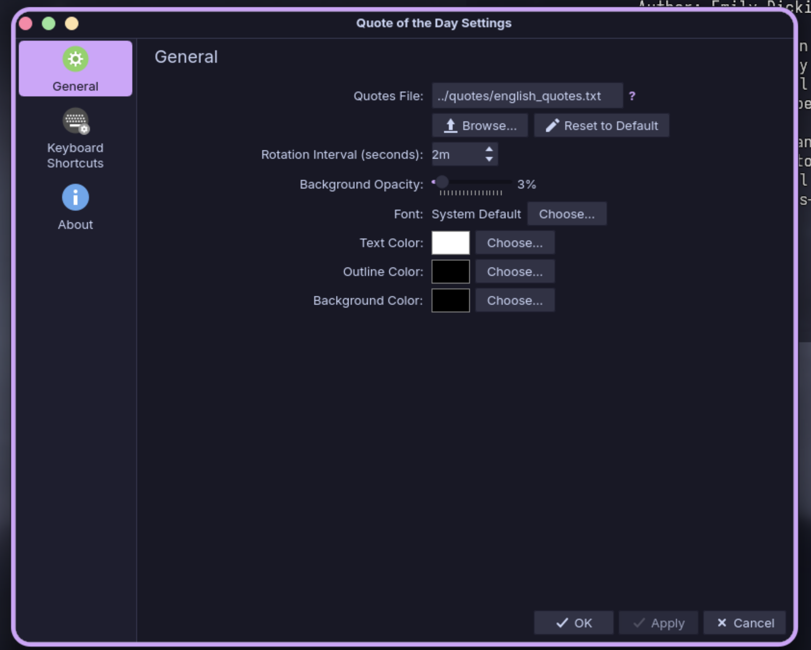

# Quote of the Day Plasmoid

A KDE Plasma widget that displays random quotes from a directory. Supports both Plasma 5 and Plasma 6.

I wanted something like this for a while, figured I'd just use an LLM to generate one - vibe coded with a bit of review of the shell scripts. Does what I need it to do. You can change the quotes file to any text file formatted as a `fortune` file.



<details>
<summary>Installation from KDE Store</summary>

1.  Right-click on your desktop, and select "Enter Edit Mode".
    

2.  Click on "Add Widgets".
    

3.  Click on "Get New Widgets" and select "Download New Plasma Widgets".
    
    

4.  Search for "Quote of the Day" and click "Install".
    

5. Now, you should be able to search for the widget locally and add it to your desktop.
    

</details>

<details>
<summary>Manual Installation</summary>

```bash
./install.sh
```

The installer auto-detects your Plasma version and installs the widget.

</details>

## Usage

1.  **Add the Widget**: Right-click on your desktop and select "Add Widgets...". Search for "Quote of the Day" and drag it to your desired location on the desktop.
2.  **Resize and Place**: You can resize the widget by dragging its edges and move it to any position on your desktop.
3.  **Default Settings**: The widget comes with default settings, so you can start using it right away.

## Configuration

If you want to customize the widget, right-click on it and select "Configure...".



This will open the configuration window:



<details>
<summary>Appearance Settings</summary>

-   **Background Opacity**: Adjust the transparency of the widget's background (0-100%).
-   **Font**: Change the font family, style, and size.
-   **Colors**: Customize the text, outline, and background colors.

</details>

<details>
<summary>Content Settings</summary>

-   **Quotes File**: You can use your own quotes file. The file must be in the `fortune` format. For detailed instructions, see [Creating Your Own Fortune File](FORTUNE_FILE_FORMAT.md). You can also download one from a public repository like [this one](https://github.com/JKirchartz/fortunes/blob/master/actualcookies).
-   **Rotation Interval**: Set the time between quote changes, from 10 seconds to 24 hours (default is 2 minutes).

</details>

## Uninstallation

To remove the widget, run the uninstallation script:

```bash
./uninstall.sh
```

## Debugging

If you encounter any issues, you can use the following scripts for debugging:

```bash
./debug.sh       # Show diagnostics
./test-widget.sh # Test in window
./watch-logs.sh  # Monitor logs
./validate.sh    # Validate package
```

## License

GPL v3
